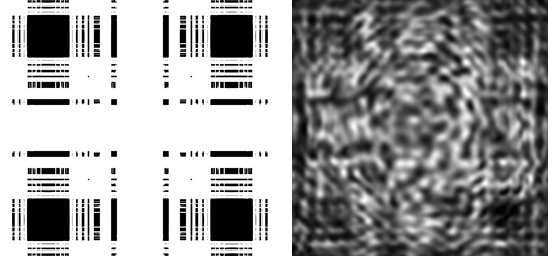
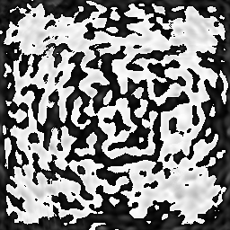
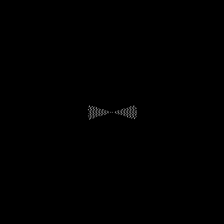

# DIFFRA-X

GPU-accelerated inverse design for diffractive optical elements (DOE) under partially coherent illumination. DIFFRA-X provides a Python/PyTorch reference implementation and a standalone C++/CUDA implementation for source-mask co-optimization.

## Optimization Result

The images below are actual outputs from the included 256 x 256 reference configuration, not schematic placeholders.



*Target input (left) and optimized reconstruction (right).*

| Optimized DOE phase | Optimized source profile |
|:---:|:---:|
|  |  |

## Highlights

- Partially coherent imaging with parameterized annular, dipole, and multipole sources.
- CUDA kernels and cuFFT-based angular-spectrum propagation in the standalone C++ path.
- Adjoint phase-gradient evaluation without a Python runtime in the C++ implementation.
- Two source-mask co-optimization strategies:
  - Version 1: 200 mask-only Adam steps followed by 50 joint mask/source steps.
  - Version 2: 200 mask-only Adam steps followed by Polak-Ribiere conjugate-gradient joint optimization.
- Streamed source-point accumulation avoids materializing the dense TCC matrix in the CUDA path, reducing peak memory growth at larger resolutions.
- JSON-driven optical, source, optimizer, input, and output configuration.

## Method

For each sampled source point, DIFFRA-X shifts the objective pupil, propagates the complex DOE field with cuFFT, and incoherently accumulates image-plane intensity. The C++ implementation evaluates the phase derivative through the adjoint optical chain. Continuous source parameters (`sigma_in`, `sigma_out`, and `open_angle`) are evaluated with central differences and updated jointly with the DOE phase.

```text
phase mask -> zero padding -> FFT -> shifted pupil
           -> angular-spectrum propagation -> intensity accumulation
           -> normalized image loss -> adjoint propagation -> phase update
```

## Repository Layout

```text
DIFFRA-X/
├── C++/                 # Standalone CUDA implementation
│   ├── include/diffrax/
│   ├── src/
│   └── CMakeLists.txt
├── Python/              # PyTorch reference implementation
│   ├── src/
│   └── config.json
├── docs/assets/         # Curated real optimization results
└── output/              # Generated runtime results (gitignored)
```

## Build the C++/CUDA Version

Requirements:

- CMake 3.24+
- A C++17 compiler
- CUDA Toolkit with cuFFT
- OpenCV 4 (`core`, `imgproc`, and `imgcodecs`)

```bash
cmake -S C++ -B build -DCMAKE_BUILD_TYPE=Release \
  -DCMAKE_CUDA_ARCHITECTURES=89
cmake --build build -j
```

Set `CMAKE_CUDA_ARCHITECTURES` for the installed GPU, for example `86` for Ampere or `89` for Ada Lovelace.

## Run

The executable accepts the path to a JSON configuration. Relative input and output paths are resolved from the configuration file directory.

```bash
./build/diffrax Python/config.json
```

Generated C++ results are written as:

```text
reconstructed_image_cpp.png
optimized_doe_phase_cpp.png
source_profile_cpp.png
optimized_source_params_cpp.json
```

Select the joint optimizer in `Python/config.json`:

```json
{
  "mask_pretrain_steps": 200,
  "joint_steps": 50,
  "joint_optimization_version": 1,
  "source": {
    "sigma_in": 0.0,
    "sigma_out": 0.2,
    "open_angle": 35.0,
    "num_poles": 2
  }
}
```

Use version `2` to enable nonlinear conjugate-gradient updates after mask pretraining.

## Python Reference

Install PyTorch, NumPy, and OpenCV, then run from the Python directory:

```bash
cd Python
python src/main.py
```

The Python implementation retains the Hopkins TCC/SOCS decomposition for reference and comparison. The C++ path uses direct source quadrature to keep source optimization and high-resolution execution practical on a single GPU.

## Notes

- The default C++ build targets CUDA architecture 89; override it at configure time when needed.
- The committed comparison images were produced by the Python reference configuration currently included in this repository.
- Runtime output directories are intentionally ignored; promote selected reproducible results into `docs/assets/` for documentation.
